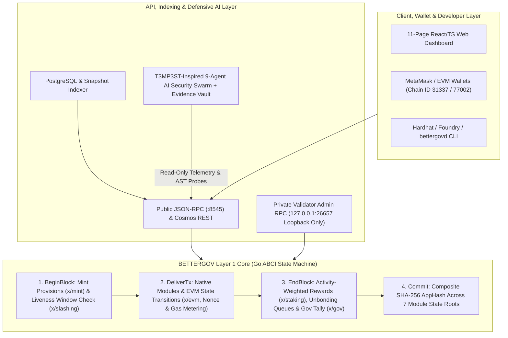

  
  <h1>BETTERGOV CHAIN (BGOV)</h1>
  <h3>TECHNICAL, ECONOMIC & REGULATORY WHITEPAPER</h3>
  
<em>An Independent EVM-Compatible Proof-of-Stake Layer 1 Blockchain for Transparent Governance, Public Accountability, Post-Quantum Identity, and Decentralized Civic Infrastructure</em>

  
<strong>Version 1.0 • November 2026 • Network Status: Local Devnet & Public Testnet Suite Implemented (Mainnet Planned Pending Independent Security Audit)</strong>

---

## Abstract

Public sector administration, fiscal budgeting, infrastructure procurement, and civic credentialing suffer from fragmented record-keeping, post-hoc data manipulation, and unverifiable audit trails. Existing general-purpose blockchains either lack native public-accountability primitives, expose citizen metadata to on-chain privacy leaks, or rely on passive speculative token models that conflict with securities and virtual-asset regulations.

**BETTERGOV Chain (`BGOV`)** is an independently operating Layer 1 blockchain built on a Cosmos SDK and CometBFT-compatible Byzantine Fault Tolerant (BFT) Proof-of-Stake architecture with full Ethereum Virtual Machine (`EVM`) execution compatibility. BETTERGOV introduces five foundational engineering contributions:

1. **Protocol-Level Public Transparency with PII Protection & Attestation Honesty (`x/transparency` & `PublicTransparencyRegistry.sol`)**: Anchors eight classes of public records using SHA-256 commitments while automatically rejecting cleartext Personally Identifiable Information (PII) and enforcing a strict distinction between unverified hash anchors (`UNVERIFIED_HASH_ANCHOR`) and independently audited records (`AUDITOR_VERIFIED`).
2. **Native Proof-of-Stake Consensus with Activity-Based Boosters (`x/staking` & `x/slashing`)**: Secures consensus via Ed25519 validator keys, delegated staking, transitive redelegation locks, 5.00% double-sign slashing with permanent tombstoning, 0.50% downtime slashing, and activity-weighted reward multipliers tied to verifiable real-world and civic contributions.
3. **SEC Classification Mitigation & BSP Circular No. 1108 VASP Separation (`NationalAssetTokenization.sol`, `CivicSBT.sol`, `TreasuryVault.sol`)**: Eliminates passive investment-contract mechanics by tying rewards to active contribution proofs, restricting fractional Real-World Asset (RWA) outputs to non-dividend functional utility credits (solar kWh discounts, warehouse storage credits), locking credentials as non-transferable ERC-5192 Soulbound Tokens (`CivicSBT`), and enforcing zero on-chain fiat (`PHP`) remittance rails.
4. **Post-Quantum Cryptographic Agility (`QuantumIdentity.sol`)**: Provides algorithm-agile public key storage slots supporting classical (`ECDSA secp256k1`, `Ed25519`) and NIST-standardized post-quantum signature schemes (**CRYSTALS-Dilithium / ML-DSA**, **Falcon-512/1024**, and **SPHINCS+ / SLH-DSA**) routed through pluggable EVM precompile verifiers.
5. **T3MP3ST-Inspired 9-Agent Defensive AI Security Subsystem (`ai-security/`)**: Operates an independent, strictly sandboxed nine-agent security swarm with an Evidence Vault, automatic secret redaction, and a provenance-strict **Live Verification Gate** (`gateLiveFinding`) that refuses to verify any security finding lacking deterministic tool-output SHA-256 receipts.

---

## Table of Contents

1. [Motivation & Core Design Principles](#1-motivation--core-design-principles)
2. [Layer 1 System & Execution Architecture](#2-layer-1-system--execution-architecture)
3. [Native Proof-of-Stake Consensus & Slashing Mechanics](#3-native-proof-of-stake-consensus--slashing-mechanics)
4. [Native Asset (`BGOV`), Monetary Policy & Activity-Based Economics](#4-native-asset-bgov-monetary-policy--activity-based-economics)
5. [Protocol Governance & Public Treasury Architecture](#5-protocol-governance--public-treasury-architecture)
6. [Public Transparency Infrastructure & PII Guard](#6-public-transparency-infrastructure--pii-guard)
7. [Regulatory Perimeter Architecture (SEC Mitigation & BSP Circular No. 1108)](#7-regulatory-perimeter-architecture-sec-mitigation--bsp-circular-no-1108)
8. [Post-Quantum Cryptographic Agility (`QuantumIdentity.sol`)](#8-post-quantum-cryptographic-agility-quantumidentitysol)
9. [T3MP3ST-Inspired 9-Agent AI Security Subsystem](#9-t3mp3st-inspired-9-agent-ai-security-subsystem)
10. [Network Environments, Verification Matrix & Mainnet Roadmap](#10-network-environments-verification-matrix--mainnet-roadmap)

---

## 1. Motivation & Core Design Principles

### 1.1 The Public Accountability Gap
Government agencies, municipal bodies, and public auditors publish thousands of procurement notices, budget releases, infrastructure milestones, and audit reports annually. When stored in centralized databases, these records are vulnerable to silent retroactive alteration, single-point deletion, and opaque verification workflows.

### 1.2 The "Hash Fallacy" & Cryptographic Honesty
A common flaw in blockchain-based governance systems is claiming that because a document's hash is recorded on-chain, the contents of the document are automatically "authentic" or "true." BETTERGOV explicitly rejects this fallacy at the protocol level:
- **Integrity vs. Truth**: Recording a SHA-256 digest $H(D)$ at block height $h$ proves **data integrity and timestamp existence** (that document $D$ existed no later than $t_h$ and has not been altered since). It does **not** prove that the claims inside $D$ are accurate.
- **Two-Stage Attestation State Machine**: Every record submitted to `x/transparency` or `PublicTransparencyRegistry.sol` initializes in the `UNVERIFIED_HASH_ANCHOR` state and carries a mandatory protocol disclaimer (`MandatoryAuthenticityDisclaimer`). A record can only transition to `AUDITOR_VERIFIED` (or `DISPUTED` / `REVOKED`) when an authorized independent auditor submits a signed `AuditEvidenceRecord` hash.

### 1.3 Privacy-Preserving Public Transparency (Off-Chain PII)
Immutable blockchains must never store cleartext citizen personal data (emails, tax identification numbers, national IDs, phone numbers). BETTERGOV enforces a deterministic **Cleartext PII Guard** (`ValidateNoCleartextPII`) across both Go state transitions and REST API gateways, rejecting any transaction containing raw PII patterns and requiring salted cryptographic commitment hashes for citizen-linked credentials.

---

## 2. Layer 1 System & Execution Architecture

BETTERGOV is structured as a modular sovereign Layer 1 blockchain (`chain/`) pairing a deterministic ABCI state machine (`BetterGovApp`) with an Ethereum-compatible execution environment (`x/evm` and `evm/contracts/`).

### 2.1 Composite State Commitment (`AppHash`)
At the conclusion of every block $h$, `BetterGovApp.ComputeAppHash()` computes a deterministic SHA-256 commitment over the state roots of all protocol modules:

$$\text{AppHash}_h = \text{SHA256}\Big(\text{JSON}\big(R_{\text{bank}} \,\|\, R_{\text{staking}} \,\|\, R_{\text{slashing}} \,\|\, R_{\text{gov}} \,\|\, R_{\text{transparency}} \,\|\, R_{\text{evm}}\big)\Big)$$

Any divergence in account balances, validator shares, slashing bit-arrays, governance tallies, transparency records, or EVM contract storage immediately alters $\text{AppHash}_h$, guaranteeing BFT state determinism across all validating nodes.

### 2.2 Administrative RPC Isolation
To prevent remote validator takeovers, `bettergovd` separates public query/transaction interfaces (`:8545`) from validator administration (`:26657`). `NewPrivateAdminMux()` enforces a strict network-layer loopback check (`ip.IsLoopback()`), returning `HTTP 403 Forbidden` to any non-`127.0.0.1`/`::1` request.

---

## 3. Native Proof-of-Stake Consensus & Slashing Mechanics

BETTERGOV implements consensus staking natively in `chain/x/staking` and `chain/x/slashing`. It does not substitute an ERC-20 staking contract for protocol consensus.

### 3.1 Validator Registration & Share Accounting
A validator $v$ registers via `CreateValidator` by providing an operator address, a unique 32-byte Ed25519 consensus public key (from which `bgovvalcons1...` is derived), commission parameters $(c_{\text{rate}}, c_{\max}, c_{\Delta\max})$, and a self-bond $T_{\text{self}} \ge T_{\min\text{-self}}$.

When a delegator bonds an amount $a$ (in `abgov`) to validator $v$ holding total bonded tokens $T_v$ and total delegator shares $S_v$, newly issued shares $s_{\text{new}}$ are computed as:

$$s_{\text{new}} = \begin{cases} a & \text{if } T_v = 0 \text{ or } S_v = 0 \\ \left\lfloor \dfrac{a \cdot S_v}{T_v} \right\rfloor & \text{otherwise} \end{cases}$$

This proportional share design ensures that if validator $v$ is slashed by a fraction $\sigma$, every delegator's underlying token claim $T_v(s) = \lfloor s \cdot T_v / S_v \rfloor$ scales down proportionally without iterating over individual delegator records during block execution.

### 3.2 Active Validator Selection
At the end of every block, `recomputeActiveValidatorSetLocked()` sorts all non-jailed, non-tombstoned validators with $T_v \ge 1\text{ BGOV}$ ($10^{18}\text{ abgov}$) deterministically by:
1. Bonded tokens $T_v$ descending, and
2. Operator address lexicographically ascending (tie-breaker).

The top $N_{\max}$ (`MaxValidators = 100`) validators form the active `BOND_STATUS_BONDED` CometBFT consensus set with voting power:

$$VP_v = \left\lfloor \frac{T_v}{10^{18}} \right\rfloor$$

### 3.3 Unbonding Queue & Transitive Redelegation Protection
- **Unbonding (`Undelegate`)**: Unbonded tokens move from `PoolBondedTokens` to `PoolNotBondedTokens` and are locked for `UnbondingTimeSeconds` (60s devnet, 86,400s testnet, 1,814,400s / 21 days mainnet) so they remain slashable for consensus faults committed prior to unbonding. If a validator's self-delegation drops below `MinSelfDelegation`, the validator is automatically jailed.
- **Transitive Redelegation Lock (`BeginRedelegate`)**: A delegator may shift stake from $v_{\text{src}}$ to $v_{\text{dst}}$ immediately, provided $v_{\text{src}}$ is not itself the destination of an immature redelegation (`ErrTransitiveRedelegation`), preventing stake from escaping slashing accountability across rapid multi-hop redelegations.

### 3.4 Slashing & Tombstoning (`x/slashing`)
| Fault Type | Detection Mechanism | Stake Slash ($\sigma$) | Consensus Consequence |
|---|---|---|---|
| **Double-Sign (Equivocation)** | Conflicting block hashes $(H_A \neq H_B)$ signed by same consensus key at $(h, r)$ | **5.00%** (`500 bps`) burned from bonded + unbonding pools | **Permanent Tombstone (`Tombstoned = true`)**; jailed until year `9999` (can never unjail) |
| **Liveness Downtime** | Sliding bit-array window (`SignedBlocksWindow`); missed blocks exceed $W - \lfloor W \cdot \text{MinSignedBps}/10000 \rfloor$ | **0.50%** (`50 bps`) burned from bonded + unbonding pools | **Temporary Jail** for `DowntimeJailDurationSec` (`600s`); eligible for `Unjail` after expiry if self-delegation $\ge T_{\min\text{-self}}$ |

---

## 4. Native Asset (`BGOV`), Monetary Policy & Activity-Based Economics

### 4.1 Native Asset Specification
- **Name**: `BetterGov`
- **Symbol / Ticker**: `BGOV`
- **Atomic Base Denomination**: `abgov` ($1\text{ BGOV} = 10^{18}\text{ abgov}$, maintaining 1:1 `wei` precision with Ethereum JSON-RPC tools and MetaMask).
- **Canonical ERC-20 Wrapper (`BGOVToken.sol`)**: Deployed on-chain to allow standard ERC-20 smart contracts and wallet token lists to wrap/unwrap and transfer `BGOV` 1:1.

### 4.2 Dynamic Inflation & Block Provision Formula (`x/mint`)
Rather than hardcoding fixed emissions, BETTERGOV implements a governance-configurable monetary policy (`EconomicParams`). At each block, the bonded stake ratio $R_{\text{bonded}}$ (in basis points) is compared against the target `GoalBondedBps` ($R_{\text{goal}} = 6700\text{ bps} = 67.00\%$):

$$R_{\text{bonded}} = \left\lfloor \frac{T_{\text{bonded}} \times 10000}{T_{\text{supply}}} \right\rfloor$$

The annual inflation rate $I_h \in [I_{\min}, I_{\max}]$ (default $[100\text{ bps}, 800\text{ bps}]$ or $[1.00\%, 8.00\%]$, initialized at $400\text{ bps} = 4.00\%$) adjusts dynamically toward $R_{\text{goal}}$, and mints a per-block provision $P_h$:

$$P_h = \left\lfloor \frac{T_{\text{supply}} \times I_h}{10000 \times B_{\text{year}}} \right\rfloor$$

Each block provision $P_h$ is split deterministically:
1. **Community Treasury Allocation ($\tau_{\text{tax}} = 1000\text{ bps} = 10\%$)**: Minted directly to `PoolTreasury` (`bgov1pool_community_treasury_00000000000`).
2. **Validator & Delegator Reward Pool ($90\%$)**: Minted to `PoolFeeCollector` (`bgov1pool_fee_collector_0000000000000000`) alongside transaction gas fees.

### 4.3 Activity-Based Reward Distribution
For each active validator $v$, its share of the reward pool is $R_v = \lfloor R_{\text{pool}} \cdot T_v / T_{\text{bonded}} \rfloor$. After deducting validator commission $C_v = \lfloor R_v \cdot c_{\text{rate}} / 10000 \rfloor$, the remaining delegator pool $D_v = R_v - C_v$ is distributed across delegators weighted by their **ActivityBoostBps** $\beta_d \in [0, 2500]$ (`+500 bps` per verified active contribution up to `+25%`):

$$w_d = s_d \times (10000 + \beta_d), \qquad R_d = \left\lfloor D_v \cdot \frac{w_d}{\sum_{j \in \text{Del}(v)} w_j} \right\rfloor$$

---

## 5. Protocol Governance & Public Treasury Architecture

### 5.1 On-Chain Governance Lifecycle (`x/gov`)
BETTERGOV uses protocol governance (`chain/x/gov/gov.go`) for consensus-critical configuration, treasury disbursements, and software upgrades:
1. **Proposal Submission & Deposit Period**: Any account may submit a `TEXT`, `PARAMETER_CHANGE`, `TREASURY_SPEND`, or `SOFTWARE_UPGRADE` proposal. Proposals enter `PROPOSAL_STATUS_VOTING_PERIOD` once total deposits reach `MinDepositAbgov` (`1,000 BGOV` devnet/testnet). Proposals failing to reach minimum deposit before `DepositEndTime` have their partial deposits burned to deter spam.
2. **Bonded-Power Voting**: Votes (`YES`, `NO`, `ABSTAIN`, `NO_WITH_VETO`) are weighted by the voter's live bonded staking power (`GetAccountVotingPower`). Voting power is re-queried at tally time so flash-unbonding cannot manipulate governance outcomes.
3. **Quorum, Approval & Veto Tallying (`EndBlocker`)**:
   - **Quorum ($Q \ge 3340\text{ bps} = 33.40\%$)**: Total participating voting power divided by total network bonded stake must be at least $33.40\%$.
   - **Veto ($V \ge 3340\text{ bps} = 33.40\%$)**: If `NO_WITH_VETO` reaches $33.40\%$ of total votes cast, the proposal is marked `PROPOSAL_STATUS_VETOED` and **its entire deposit is burned**.
   - **Approval Threshold ($T > 5000\text{ bps} = 50.00\%$)**: If quorum is met and the proposal is not vetoed, `YES` votes must strictly exceed $50.00\%$ of non-abstain votes (`YES + NO + NO_WITH_VETO`). Passed proposals refund deposits and execute automatically at `EndBlocker`.

### 5.2 Keyless Protocol Treasury Pool & Milestone Vault
The on-chain Community Treasury (`bgov1pool_community_treasury_00000000000`) is a **Protocol Module Account with no private key**. No individual operator or government official can sign transactions from it; funds move out of `PoolTreasury` exclusively via passed `TREASURY_SPEND` proposals or milestone-verified grants in `TreasuryVault.sol` (which requires both an `auditProofHash` and an `activityContributionProofHash`).

---

## 6. Public Transparency Infrastructure & PII Guard

Implemented natively in `chain/x/transparency/transparency.go` and on the EVM in `evm/contracts/PublicTransparencyRegistry.sol`, BETTERGOV provides eight structured record schemas:

1. **Public Document Verification (`DocumentRecord`)**: Anchors agency code, off-chain IPFS/HTTPS URI, and SHA-256 document hash.
2. **Government Project Tracking (`GovernmentProject`)**: Tracks regional infrastructure budgets, disbursed `abgov`, milestone counts, completion basis points, and specification hashes.
3. **Procurement Transparency (`ProcurementRecord`)**: Anchors tender notice hashes, bid evaluation hashes, total bids count, winning bidder address, and contract value.
4. **Budget Allocation Records (`BudgetAllocation`)**: Tracks fiscal year, department, program code, appropriation law hash, allocated `abgov`, and released `abgov`.
5. **Community Participation (`CommunityParticipation`)**: Anchors pseudonymous citizen testimony and public consultation hashes without exposing citizen identities.
6. **Public Audit Evidence (`AuditEvidenceRecord`)**: Links independent auditor verification methodology and SHA-256 evidence packages to target records.
7. **Digital Certificates (`DigitalCertificate`)**: Issues verifiable civic certificates with salted subject commitment hashes, expiration timestamps, and revocation states.
8. **Timestamped Anchors (`TimestampRecord`)**: Generates deterministic Merkle anchors (`SHA256(id : payloadHash : height : blockTime)`).

---

## 7. Regulatory Perimeter Architecture (SEC Mitigation & BSP Circular No. 1108)

BETTERGOV embeds regulatory perimeter safeguards directly into protocol state transition rules and smart contract invariants:

### 7.1 SEC Classification Mitigation
1. **Activity-Based Rewards (`NationalAssetTokenization.sol`, `TreasuryVault.sol`, `x/staking`)**:
   - Reward boosters and RWA utility credit claims require verifiable **Active Contributions** (`CLEAN_ENERGY_GENERATION`, `CROP_HARVEST_SUBMISSION`, `GOVERNANCE_PROPOSAL_VOTE`, `PUBLIC_AUDIT_ATTESTATION`).
   - In `NationalAssetTokenization.sol`, calling `claimFunctionalUtilityCredits` with `totalActivityPoints == 0` reverts with `PassiveReturnProhibitedRequiresActiveContribution()`, eliminating passive return expectations from the mere holding of tokens.
2. **Non-Dividend RWA Shares (`NationalAssetTokenization.sol`)**:
   - Fractional RWA allocations distribute output **exclusively** as non-monetary **Functional Utility Credits** (`SOLAR_ENERGY_KWH_DISCOUNT`, `WAREHOUSE_STORAGE_CREDIT`, `IRRIGATION_WATER_ALLOCATION`, `COLD_CHAIN_LOGISTICS_OFFSET`).
   - Monetary dividends are prohibited at the contract level (`receive() external payable` reverts with `MonetaryDividendsAndFiatRailsProhibited()`).
3. **Non-Transferable Soulbound Credentials (`CivicSBT.sol`)**:
   - Academic degree levels, civic identity tiers, auditor reputations, and producer badges are minted as ERC-5192 permanently locked Soulbound Tokens (`locked(tokenId) == true`).
   - All transfer and approval methods (`transferFrom`, `safeTransferFrom`, `approve`, `setApprovalForAll`) unconditionally revert with `SoulboundNonTransferable()`, preventing secondary market speculation on identity or reputation.

### 7.2 BSP Circular No. 1108 (VASP Separation)
- **Strict Crypto-Utility Layer Execution**: Both the Go Layer 1 (`bank.ValidateBSP1108CryptoUtilityOnly`) and all seven EVM smart contracts contain **zero direct Philippine Peso (`PHP`) fiat rails**, fiat custody pools, or on-chain remittance settlement functions.
- **Off-Chain VASP Boundary**: Any conversion between fiat currency and utility tokens occurs strictly off-chain through independently licensed Virtual Asset Service Providers (VASPs), keeping protocol execution outside unlicensed remittance or e-money classifications.

---

## 8. Post-Quantum Cryptographic Agility (`QuantumIdentity.sol`)

Because public governance records, property/procurement registries, and citizen commitments must remain secure over multi-decade horizons, `evm/contracts/QuantumIdentity.sol` implements cryptographic agility via algorithm-indexed key slots:

$$\text{keySlots}: \text{Address} \times \text{AlgorithmType} \longrightarrow \big(\text{publicKey}, \text{keyCommitmentHash}, \text{keyEpoch}, \text{registeredAt}, \text{active}, \text{revoked}\big)$$

### Supported Algorithm Slots
- `0: ECDSA_SECP256K1` — Classical Ethereum 65-byte elliptic curve key
- `1: ED25519` — Classical CometBFT 32-byte consensus key
- `2: DILITHIUM_ML_DSA_65` — NIST FIPS 204 (CRYSTALS-Dilithium) lattice-based post-quantum signature
- `3: FALCON_512` — NIST FN-DSA compact lattice post-quantum signature
- `4: FALCON_1024` — NIST Level-5 high-security lattice post-quantum signature
- `5: SPHINCS_PLUS_SHA256` — NIST FIPS 205 (SLH-DSA) stateless hash-based post-quantum signature

When EVM post-quantum precompiles are enabled via network upgrade, governance binds each `AlgorithmType` to its precompile verifier address via `setAlgorithmPrecompileVerifier(algorithm, precompileAddr)`, enabling `verifyWithAgilePrecompile()` without requiring users or agencies to migrate account addresses.

---

## 9. T3MP3ST-Inspired 9-Agent AI Security Subsystem

Modeled on the architectural principles of `elder-plinius/T3MP3ST`, `ai-security/` provides an autonomous, evidence-first defensive security subsystem composed of nine specialized agents:

| # | Agent | Operational Scope | Tool / Evidence Output Type |
|---|---|---|---|
| 1 | **Validator Guardian** | Monitors validator liveness windows, commission changes & BFT voting power concentration ($\ge 33.34\%$) | `rpc_response` (`cosmos_slashing_signing_info`) |
| 2 | **Network Sentinel** | Monitors P2P peer counts, outbound connections & `/16` subnet diversity against eclipse attacks | `rpc_response` (`cometbft_net_info`) |
| 3 | **Contract Auditor** | Static AST & bytecode scanner for reentrancy, `tx.origin`, and BSP 1108 / SEC perimeter violations | `ast_match` (`solidity_static_scanner`) |
| 4 | **Transaction Analyst** | Monitors large treasury outflows, abnormal gas spikes & nonce replay attempts | `tx_receipt` (`eth_getTransactionReceipt`) |
| 5 | **Governance Analyst** | Detects flash-stake quorum manipulation & extreme parameter change proposals | `rpc_response` (`cosmos_gov_proposal_query`) |
| 6 | **Evidence Collector** | Captures tool outputs, computes SHA-256 receipts & redacts raw secrets (`[REDACTED_SECRET_CAPTURED=true]`) | `EvidenceVault` deduplicated entry |
| 7 | **Verification Agent** | Executes the **Live Verification Gate** (`gateLiveFinding`) across all vault findings | `verifyGate` provenance verdict |
| 8 | **Security Coordinator** | Priority-ordered `TaskQueue` & `MissionControl` orchestrator across all 9 agents | Mission execution plan |
| 9 | **Report Generator** | Produces reproducible JSON & Markdown audit reports with ledger SHA-256 digests | `BGOV-AUDIT-*` report bundle |

### 9.1 The Live Verification Gate (`gateLiveFinding`)
Following T3MP3ST's provenance-strict architecture, a finding in `EvidenceVault` cannot be self-stamped as `verified` by an agent or LLM prose. `gateLiveFinding()` inspects `finding.evidence` and requires at least one machine-generated tool artifact (`rpc_response`, `tx_receipt`, `ast_match`, `block_header`, `output`, `log`) with a valid 64-character hexadecimal SHA-256 receipt. Unverified model hypotheses are blocked from verification (`passed: false`, `provenance: 'none'`) and have their severity capped to `low`.

### 9.2 Immutable Agent Permission Boundary
Every agent is instantiated via `createControlledPermissions` (`ai-security/verification/gate.mjs`) with frozen, non-overridable safety flags:
- `canChangeConsensus: false`
- `canAccessValidatorPrivateKeys: false`
- `canExecuteArbitraryTransactions: false`
- `canSeizeUserFunds: false`

Any attempt to invoke a forbidden capability triggers an immediate `SECURITY_VIOLATION` exception.

---

## 10. Network Environments, Verification Matrix & Mainnet Roadmap

### 10.1 Environment Separation
| Environment | Cosmos Chain ID | EVM Chain ID | Unbonding Period | Status |
|---|---|---|---|---|
| **Local Devnet** | `bettergov-devnet-1` | `31337` (`0x7a69`) | `60 seconds` | **LIVE / IMPLEMENTED** |
| **Public Testnet** | `bettergov-testnet-1` | `77002` (`0x12ccf`) | `86,400 seconds` (1 day) | **CONFIGURED & VALIDATED** |
| **Mainnet** | `TBD_VERIFY_BEFORE_MAINNET` | `0` *(Reserve via EIP-155 PR)* | `1,814,400 seconds` (21 days) | **PLANNED (Template Only)** |

### 10.2 Pre-Mainnet Readiness Gates
BETTERGOV does not claim to be a live Mainnet prior to external validation. Transitioning from the Public Testnet to Mainnet requires:
1. **Independent Third-Party Security Audit**: External cryptographic review of `chain/x/` Go modules and all seven Solidity contracts in `evm/contracts/`.
2. **Identifier Registration**: Formal reservation of a non-colliding EIP-155 Chain ID in `ethereum-lists/chains` and the Cosmos Chain Registry.
3. **Decentralized Genesis Ceremony**: Independent institutional and civic validator operators generating hardware-backed Ed25519 consensus keys (`tmkms` / HSM) with zero shared devnet mnemonics.
4. **Published Economic Policy Ratification**: Community ratification of final genesis supply, inflation bounds, and slashing parameters.

