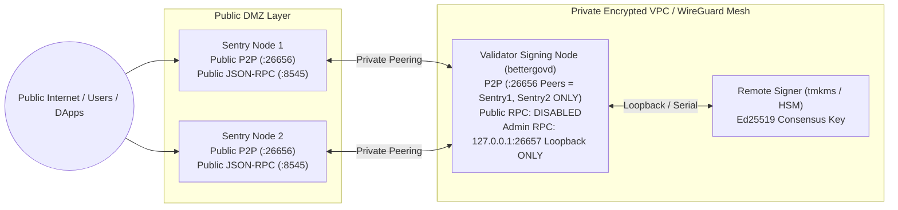

<div align="center">
  
  <h1>BETTERGOV CHAIN (BGOV) — VALIDATOR OPERATOR GUIDE</h1>
  <p><strong>Complete Technical Guide to Building, Registering, Securing, and Operating a Proof-of-Stake Validator on BETTERGOV Layer 1</strong></p>
</div>

---

## Table of Contents

1. [Overview: What Does a BETTERGOV Validator Do?](#1-overview-what-does-a-bettergov-validator-do)
2. [Hardware, OS & Network Requirements](#2-hardware-os--network-requirements)
3. [Validator Key Architecture (Two-Key Separation)](#3-validator-key-architecture-two-key-separation)
4. [Protocol Staking & Commission Parameters](#4-protocol-staking--commission-parameters)
5. [Step-by-Step: How to Become a Validator](#5-step-by-step-how-to-become-a-validator)
6. [Inspecting & Managing Your Validator](#6-inspecting--managing-your-validator)
7. [Slashing, Jailing, Tombstoning & Unjail Recovery](#7-slashing-jailing-tombstoning--unjail-recovery)
8. [Production Security: Sentry Topology & Loopback Admin RPC](#8-production-security-sentry-topology--loopback-admin-rpc)
9. [AI Security Monitoring (`ValidatorGuardian` & `NetworkSentinel`)](#9-ai-security-monitoring-validatorguardian--networksentinel)
10. [Local Devnet & Testnet Genesis Validators Reference](#10-local-devnet--testnet-genesis-validators-reference)

---

## 1. Overview: What Does a BETTERGOV Validator Do?

**BETTERGOV Chain (`BGOV`)** is an independent Proof-of-Stake (PoS) Layer 1 blockchain (`chain/x/staking`, `chain/x/slashing`). Consensus is secured at the protocol layer by up to **100 active validators** (`MaxValidators = 100`) ranked by total bonded `BGOV` (`abgov`).

As a validator operator, your node is responsible for:
1. **Block Proposal & BFT Attestation**: Signing and finalizing blocks using your **32-byte Ed25519 consensus key**.
2. **State Machine Execution**: Executing native transactions (`bank`, `staking`, `gov`, `transparency`) and Ethereum Virtual Machine (`x/evm`) smart contracts to compute the deterministic block `AppHash`.
3. **Delegation & Reward Distribution**: Accepting delegated `BGOV` from community delegators and earning block provisions (`90%` of minted block rewards + gas fees after the `10%` Community Treasury tax).
4. **Protocol Governance**: Voting on `TEXT`, `PARAMETER_CHANGE`, `TREASURY_SPEND`, and `SOFTWARE_UPGRADE` proposals in `chain/x/gov`.

> [!IMPORTANT]
> **Environment Status**: You can run a validator right now on the **Local Devnet (`bettergov-devnet-1`, EVM ID `31337`)** or **Public Testnet (`bettergov-testnet-1`, EVM ID `77002`)**. Mainnet (`genesis/mainnet/mainnet.template.json`) is in `PLANNED` status pending independent third-party security audit.

---

## 2. Hardware, OS & Network Requirements

| Resource | Local Devnet (`bettergov-devnet-1`) | Public Testnet (`bettergov-testnet-1`) | Planned Mainnet Target |
|---|---|---|---|
| **CPU** | 2+ vCPU (x86_64 / ARM64) | 4+ Dedicated vCPU (3.2 GHz+) | 8+ Dedicated Cores |
| **RAM** | 4 GB | 16 GB ECC | 32–64 GB ECC |
| **Storage** | 20 GB SSD | 500 GB NVMe SSD | 2 TB Enterprise NVMe SSD (RAID-1) |
| **Network** | Localhost / Loopback | 250 Mbps symmetric (`99.5%+` uptime) | 1 Gbps symmetric + redundant ISP |
| **Go Toolchain** | Go `1.22+` (Tested on `Go 1.27`) | Go `1.22+` | Go `1.22+` + Hardware HSM (`tmkms`) |

### Firewall & Port Matrix

| Port | Bind Interface | Protocol | Purpose | Exposure Policy |
|---|---|---|---|---|
| `8545` | `127.0.0.1:8545` (or Sentry Public IP) | HTTP (`JSON-RPC` & `REST`) | Ethereum `eth_*` RPC & Cosmos `/cosmos/*`, `/bettergov/*` REST | Expose **only on Sentry / RPC nodes**; keep firewalled on signing validator |
| `26657` | `127.0.0.1:26657` | HTTP (`Private Admin RPC`) | `/admin/validator-set`, `/admin/snapshot` | **STRICT LOOPBACK ONLY (`127.0.0.1` / `::1`)** — enforced in code (`HTTP 403` to external IPs) |
| `26656` | `0.0.0.0:26656` | TCP (CometBFT P2P) | Validator-to-Sentry peer gossip | Restrict validator node to trusted Sentry node IPs only |

---

## 3. Validator Key Architecture (Two-Key Separation)

BETTERGOV strictly separates your **Operator Wallet Key** from your **Consensus Block-Signing Key** (`chain/x/staking/staking.go`):

| Key Type | Format / Algorithm | Example | Purpose | Storage Recommendation |
|---|---|---|---|---|
| **1. Operator Address (`operator_address`)** | 20-byte EVM Hex (`0x...`, ECDSA `secp256k1`) | `0x70997970c51812dc3a010c7d01b50e0d17dc79c8` | Holds self-bonded `BGOV`, updates commission, calls `Unjail`, votes in governance | Cold hardware wallet (Ledger / air-gapped signer) |
| **2. Consensus Public Key (`consensus_pubkey_hex`)** | 32-byte Hex (64 hex chars, `Ed25519`) | `1111111111111111111111111111111111111111111111111111111111111111` | Signs blocks; deterministically derives `bgovvalcons1...` (`SHA256(pubKey)[:20]`) | Remote signer (`tmkms`) or encrypted validator host |
| **3. Post-Quantum Identity Slot (`QuantumIdentity.sol`)** | `DILITHIUM_ML_DSA_65`, `FALCON_512/1024`, `SPHINCS_PLUS_SHA256` | Registered via `registerAgileKeySlot()` | Optional NIST post-quantum cryptographic agility slot bound to operator address | Offline PQ key vault |

---

## 4. Protocol Staking & Commission Parameters

Enforced by `chain/x/staking/staking.go` (`CreateValidator` & `UpdateCommission`):

| Parameter | Devnet (`bettergov-devnet-1`) | Testnet (`bettergov-testnet-1`) | Rule / Enforcement |
|---|---|---|---|
| **Bond Denomination (`bond_denom`)** | `abgov` ($1\text{ BGOV} = 10^{18}\text{ abgov}$) | `abgov` ($1\text{ BGOV} = 10^{18}\text{ abgov}$) | Must stake in `abgov` |
| **Max Active Validators (`max_validators`)** | `100` | `100` | Top 100 non-jailed validators by total bonded `BGOV` |
| **Minimum Self-Delegation (`min_self_delegation`)** | $\ge 50,000\text{ BGOV}$ (`50000000000000000000000 abgov`) | $\ge 50,000\text{ BGOV}$ (`50000000000000000000000 abgov`) | Self-bond must be $\ge \text{min\_self\_delegation}$ or validator is auto-jailed |
| **Min Commission Rate (`min_commission_rate_bps`)** | `500 bps` (`5.00%`) | `500 bps` (`5.00%`) | Rejects `rate_bps < 500` (`ErrInvalidCommission`) |
| **Max Commission Rate (`max_rate_bps`)** | Up to `10000 bps` (`2000 bps` / `20%` recommended) | Up to `10000 bps` (`2000 bps` / `20%` recommended) | Immutable ceiling set at validator creation |
| **Max Commission Change (`max_change_rate_bps`)** | `100 bps` (`1.00%` per update) | `100 bps` (`1.00%` per update) | Rejects jumps $> \text{max\_change\_rate\_bps}$ (`ErrCommissionChangeTooLarge`) |
| **Unbonding Time (`unbonding_time_seconds`)** | `60 seconds` | `86,400 seconds` (24 hours) | `1,814,400 seconds` (21 days) on Mainnet |

---

## 5. Step-by-Step: How to Become a Validator

### Step 1: Build the `bettergovd` Node Binary

Open PowerShell or Bash in the repository root (`c:\Users\janla\BetterGov`):

```powershell
cd chain
go test -v ./...
go build -o bettergovd.exe ./cmd/bettergovd
./bettergovd.exe status
```

Expected output:
```json
{
  "active_validators": 4,
  "app_hash": "86fa35b13f36fb2c134b04e6ec8eb262ce8f18229ff704892cf263e6c5ba7321",
  "chain_id": "bettergov-devnet-1",
  "evm_chain_id": 31337,
  "height": 1,
  "node": "bettergovd/v1.0.0",
  "total_bonded": "7800000000000000000000000"
}
```

---

### Step 2: Generate Your Unique Ed25519 Consensus Public Key

Every validator must have a **unique** 32-byte (64-character hex) Ed25519 consensus public key (`ErrConsensusKeyExists` is thrown if a duplicate key is used).

You can generate a fresh cryptographic Ed25519 consensus keypair using Node.js:

```powershell
node -e '
const crypto = require("crypto");
const { publicKey, privateKey } = crypto.generateKeyPairSync("ed25519");
const pubRaw = publicKey.export({ type: "spki", format: "der" }).subarray(-32).toString("hex");
const privRaw = privateKey.export({ type: "pkcs8", format: "der" }).subarray(-32).toString("hex");
const consAddr = "bgovvalcons1" + crypto.createHash("sha256").update(Buffer.from(pubRaw, "hex")).digest("hex").slice(0, 40);
console.log(JSON.stringify({ consensus_pubkey_hex: pubRaw, consensus_privkey_hex_SECRET: privRaw, consensus_address: consAddr }, null, 2));
'
```

> [!CAUTION]
> **Save `consensus_privkey_hex_SECRET` offline.** Never commit it to Git or share it. Share only `consensus_pubkey_hex` when registering your validator.

---

### Step 3: Register Your Validator in Genesis (Devnet / Testnet Onboarding)

To add your validator to a local devnet or testnet genesis file (`genesis/devnet/genesis.json` or `genesis/testnet/genesis.json`):

1. Add your **Operator Address** and initial `BGOV` balance (in `abgov`, where $1\text{ BGOV} = 10^{18}\text{ abgov}$) under `"accounts"`:
   ```json
   {
     "address": "0x9965507d1a55bcc2695c58ba16fb37d819b0a4dc",
     "balance_abgov": "5000000000000000000000000"
   }
   ```
2. Add your **Validator Registration Entry** under `"validators"`:
   ```json
   {
     "operator_address": "0x9965507d1a55bcc2695c58ba16fb37d819b0a4dc",
     "consensus_pubkey_hex": "<YOUR_64_CHAR_ED25519_PUBKEY_HEX>",
     "moniker": "Mindanao-Civic-Validator",
     "website": "https://mindanao-validator.bettergov.org",
     "security_contact": "security@mindanao-validator.org",
     "details": "Independent Regional Civic Infrastructure Validator — Davao Zone",
     "self_bond_abgov": "1500000000000000000000000",
     "min_self_delegation_abgov": "50000000000000000000000",
     "commission": {
       "rate_bps": 500,
       "max_rate_bps": 2000,
       "max_change_rate_bps": 100,
       "updated_at": "2026-11-06T00:00:00Z"
     }
   }
   ```
3. Validate the updated genesis file using `bettergovd`:
   ```powershell
   ./bettergovd.exe genesis-validate --file ../genesis/devnet/genesis.json
   ```
   If all balances, self-bonds, commission bounds, and Ed25519 keys are valid, `bettergovd` prints:
   ```text
   [bettergovd] genesis VALID: chain_id=bettergov-devnet-1 evm_chain_id=31337 validators=5 initial_app_hash=...
   ```

---

### Step 4: Programmatic / Live Validator Registration (`CreateValidator`)

In the Go state machine (`chain/x/staking/staking.go`), a new validator can also join a live running network after genesis by invoking `Staking.CreateValidator`:

```go
oneBGOV := bank.OneBGOV() // 10^18 abgov
selfBond := new(big.Int).Mul(big.NewInt(1_500_000), oneBGOV)       // 1,500,000 BGOV self-bond
minSelf  := new(big.Int).Mul(big.NewInt(50_000), oneBGOV)          // 50,000 BGOV min self-delegation

val, err := chainApp.Staking.CreateValidator(
    "0x9965507d1a55bcc2695c58ba16fb37d819b0a4dc",                  // Operator Address
    "a1b2c3d4e5f60718293a4b5c6d7e8f90a1b2c3d4e5f60718293a4b5c6d7e8f90", // 32-byte Ed25519 PubKey Hex
    "Mindanao-Civic-Validator",                                    // Moniker
    "https://mindanao-validator.bettergov.org",                    // Website
    "sec-contact-mindanao",                                        // Security Contact
    "Independent Regional Civic Validator",                        // Details
    selfBond,
    minSelf,
    staking.CommissionRates{
        RateBps:          500,  // 5.00% initial commission
        MaxRateBps:       2000, // 20.00% max ceiling
        MaxChangeRateBps: 100,  // 1.00% max change per update
    },
    blockTime,
)
```

---

### Step 5: Start Your Validator Node

```powershell
cd chain
./bettergovd.exe start --rpc-bind 127.0.0.1:8545 --admin-bind 127.0.0.1:26657 --block-time 3s
```

---

## 6. Inspecting & Managing Your Validator

While `bettergovd` is running, you can inspect your validator's live consensus status, voting power, commission, and slash history using standard HTTP queries:

### 6.1 Query All Active & Candidate Validators (Public REST)
```powershell
Invoke-RestMethod -Uri "http://127.0.0.1:8545/cosmos/staking/v1beta1/validators" | ConvertTo-Json -Depth 5
```

### 6.2 Query Consensus Validator Updates & Slash Events (Private Loopback Admin RPC)
```powershell
Invoke-RestMethod -Uri "http://127.0.0.1:26657/admin/validator-set" | ConvertTo-Json -Depth 5
```

### 6.3 Query Network Bonded Ratio & Dynamic Inflation
```powershell
Invoke-RestMethod -Uri "http://127.0.0.1:8545/bettergov/network/status" | ConvertTo-Json -Depth 4
```

### 6.4 View in the Web Dashboard (`Staking & Validators` Page)
Open `http://127.0.0.1:5173` and click **Staking & Validators** in the top navigation bar to view:
- Moniker, Operator Address (`0x...`), and Consensus Address (`bgovvalcons1...`)
- Bonded Stake (`BGOV`), Self-Bond, and Commission Rate (`%`)
- Live `BOND_STATUS_BONDED` / `JAILED` / `TOMBSTONED` status badge
- One-click **Delegate** and **Verify Activity Boost (`+5%` to `+25%`)** controls

---

## 7. Slashing, Jailing, Tombstoning & Unjail Recovery

BETTERGOV enforces strict protocol-level slashing in `chain/x/slashing/slashing.go` to protect network integrity:

| Infraction | Trigger Condition | Stake Penalty ($\sigma$) | Jail / Tombstone Consequence | Recovery Path |
|---|---|---|---|---|
| **1. Double-Signing (Equivocation)** | Signing two different block hashes $(H_A \neq H_B)$ at the same `(height, round)` with the same Ed25519 consensus key | **5.00% (`500 bps`)** of total bonded + unbonding stake is **permanently burned** | **Permanently Tombstoned (`Tombstoned = true`)**; jailed until year `9999` | **NONE (Irreversible).** Operator and consensus key are permanently barred from consensus. |
| **2. Liveness Downtime** | Missing $>50\%$ of blocks within `SignedBlocksWindow` (`100` blocks devnet / `1,000` blocks testnet) | **0.50% (`50 bps`)** of total bonded + unbonding stake is **burned** | **Temporarily Jailed (`Jailed = true`)** for `DowntimeJailDurationSec` (`600 seconds` / 10 minutes) | Wait for `JailedUntil` to expire, verify `SelfDelegation >= MinSelfDelegation`, and submit `Unjail`. |
| **3. Self-Bond Violation** | Validator unbonds self-stake below `MinSelfDelegation` | `0%` burn | **Automatically Jailed (`Jailed = true`)** and removed from active set | Self-delegate `BGOV` so self-bond $\ge \text{MinSelfDelegation}$, then submit `Unjail`. |

### Golden Rule for Validator Operators: Never Double-Sign
- **Never** run an active validator and a backup/failover validator at the same time with the same `consensus_pubkey_hex`.
- When migrating servers, **stop the old validator process completely**, verify it has stopped signing for at least 2 blocks, and copy the latest state before starting the new server.

---

## 8. Production Security: Sentry Topology & Loopback Admin RPC

For Public Testnet (`bettergov-testnet-1`) and future Mainnet deployments, never expose your validator signing node directly to the public internet. Use a **Sentry Node Architecture**:



### Built-In Loopback Protection (`NewPrivateAdminMux`)
In `chain/app/rpc.go`, the validator administrative RPC (`:26657`) enforces `ip.IsLoopback()`. Even if a firewall is misconfigured, any request originating outside `127.0.0.1` or `::1` is automatically rejected with:
```text
HTTP 403 Forbidden: FORBIDDEN: administrative validator RPC is restricted to loopback (127.0.0.1 / ::1)
```

---

## 9. AI Security Monitoring (`ValidatorGuardian` & `NetworkSentinel`)

BETTERGOV includes a built-in **T3MP3ST-Inspired 9-Agent Defensive AI Security Subsystem** (`ai-security/`) that validators can run locally to monitor their node health, liveness windows, voting-power concentration, and P2P eclipse risks:

```powershell
cd ai-security
npm test
npm run audit
```

Specifically for validators:
- **Agent 1 (`ValidatorGuardian`)**: Audits your missed-block counter against `SignedBlocksWindow` and alerts if any single validator approaches the $\ge 33.34\%$ BFT consensus halt threshold.
- **Agent 2 (`NetworkSentinel`)**: Inspects inbound/outbound peer counts and `/16` IPv4 subnet diversity to warn against eclipse attacks before downtime slashing can occur.

---

## 10. Local Devnet & Testnet Genesis Validators Reference

For local development and testing on `bettergov-devnet-1`, the following 4 Genesis Validators are pre-configured in `genesis/devnet/genesis.json`:

| # | Moniker | Operator Address (`0x...`) | Consensus Public Key (`Ed25519` Hex) | Self-Bond | Commission | Deterministic Devnet Private Key *(Test Only)* |
|---|---|---|---|---|---|---|
| **1** | `Sentinel-Alpha-Node` | `0x70997970c51812dc3a010c7d01b50e0d17dc79c8` | `1111...1111` (64 chars) | `2,500,000 BGOV` | `5.00%` (`500 bps`) | `0x59c6995e998f97a5a0044966f0945389dc9e86dae88c7a8412f4603b6b78690d` |
| **2** | `CivicTrust-Validator` | `0x3c44cdddb6a900fa2b585dd299e03d12fa4293bc` | `2222...2222` (64 chars) | `2,000,000 BGOV` | `7.00%` (`700 bps`) | `0x5de4111afa1a4b94908f83103eb1f1706367c2e68ca870fc3fb9a804cdab365a` |
| **3** | `Aegis-GovTech-Staking` | `0x90f79bf6eb2c4f870365e785982e1f101e93b906` | `3333...3333` (64 chars) | `1,800,000 BGOV` | `6.00%` (`600 bps`) | `0x7c852118294e51e653712a81e05800f419141751be58f605c371e15141b007a6` |
| **4** | `OpenLedger-Guard` | `0x15d34aaf54267db7d7c367839aaf71a00a2c6a65` | `4444...4444` (64 chars) | `1,500,000 BGOV` | `8.00%` (`800 bps`) | `0x47e179ec197488593b187f80a00eb0da91f1b9d0b13f8733639f19c30a34926a` |

> [!WARNING]
> **Never use the above test keys on a public network with real value.** Those keys are public Hardhat/Anvil test vectors included strictly for local devnet verification.

