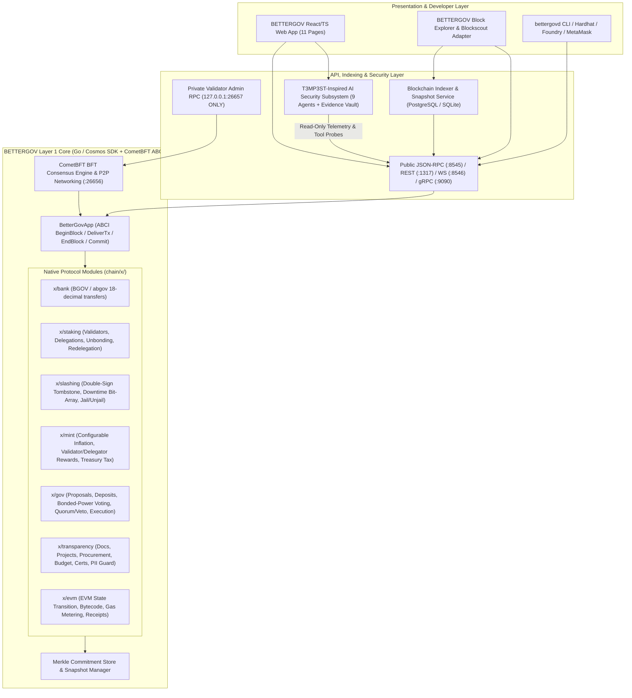

# BETTERGOV CHAIN — System Architecture Specification

## 1. Mission & Architectural Principles

**BETTERGOV (`BGOV`)** is an independent, EVM-compatible Proof-of-Stake Layer 1 blockchain designed for transparent public governance, fiscal accountability, verifiable public records, and resilient decentralized infrastructure.

### Core Engineering Tenets
1. **Protocol-Level Proof-of-Stake Consensus**: Consensus security is anchored by native validator self-bonding, delegated staking, deterministic CometBFT-style validator set updates, proportional reward distribution, and protocol-enforced slashing for double-signing and downtime—never an ERC-20 staking simulation.
2. **Dual Execution Environment**:
   - **Native Cosmos Modules (`chain/x/`)**: Deterministic state machines for `bank`, `staking`, `slashing`, `mint`, `gov`, `transparency`, and `evm`.
   - **EVM Execution Layer (`chain/x/evm` & `evm/contracts/`)**: Full Ethereum JSON-RPC compatibility (`eth_*`, `net_*`, `web3_*`), 18-decimal `BGOV` (`abgov` base unit), MetaMask connectivity, and Solidity smart contracts for public transparency registries and multi-milestone treasury vaults.
3. **Public Transparency with Cryptographic Integrity & Honesty**:
   - Sensitive Personally Identifiable Information (PII) is strictly kept off-chain; on-chain modules reject cleartext PII patterns and store only SHA-256 cryptographic hashes, IPFS/HTTPS content URIs, issuer signatures, and verification metadata.
   - Every on-chain record carries a protocol-level `AttestationDisclaimer` and explicit `VerificationStatus` (`UNVERIFIED_SUBMISSION`, `AUDITOR_VERIFIED`, `DISPUTED`, `REVOKED`) so that an on-chain hash is never misrepresented as proof that the underlying claim is true without independent audit verification.
4. **T3MP3ST-Inspired Defensive AI Security (`ai-security/`)**:
   - An independent, strictly sandboxed 9-agent security subsystem with an Evidence Vault, secret redaction, and a Live Verification Gate (`provenance: 'tool'` required).
   - Zero consensus privileges: AI agents cannot modify consensus state, access validator keys, sign transactions, or move funds.

---

## 2. Layered System Architecture

---

## 3. Native Token (`BGOV`) & Configurable Economic Policy

| Parameter | Value / Key | Description |
|---|---|---|
| **Token Name** | `BetterGov` | Human-readable native asset name |
| **Ticker Symbol** | `BGOV` | Display symbol (`1 BGOV = 10^18 abgov`) |
| **Base Denomination** | `abgov` | Atomic on-chain unit (18 decimals for 1:1 EVM `wei` parity) |
| **Genesis Supply** | Configurable (`GenesisSupply`) | Default devnet/testnet: `100,000,000 BGOV` (configurable in `genesis.json`) |
| **Annual Inflation Rate** | Configurable (`InflationRateBps`) | Default: `400 bps` (4.00% annual), bounded by `InflationMinBps` (100) and `InflationMaxBps` (800) |
| **Goal Bonded Ratio** | Configurable (`GoalBondedBps`) | Default: `6700 bps` (67.00% of supply staked) |
| **Community Treasury Tax** | Configurable (`CommunityTaxBps`) | Default: `1000 bps` (10.00% of minted rewards + fees directed to Governance Treasury) |
| **Proposer Base/Bonus** | Configurable (`BaseProposerRewardBps`) | Default: `100 bps` base + `400 bps` bonus proportional to precommit signatures |
| **Unbonding Period** | Configurable (`UnbondingTimeSeconds`) | Devnet: `60s`; Testnet: `86,400s` (1 day); Mainnet template: `1,814,400s` (21 days) |
| **Slash Fraction (Double Sign)** | Configurable (`SlashFractionDoubleSignBps`) | Default: `500 bps` (5.00% of bonded stake) + permanent `Tombstoned = true` |
| **Slash Fraction (Downtime)** | Configurable (`SlashFractionDowntimeBps`) | Default: `50 bps` (0.50% of bonded stake) + jailed for `DowntimeJailDuration` |

> [!IMPORTANT]
> **Tokenomics Governance Note**: Final mainnet tokenomics are intentionally not hardcoded. All supply, emission, tax, and slashing parameters live in `genesis.json` and on-chain governance parameter stores so they can be audited and ratified prior to mainnet launch.

---

## 4. Network Environments & Chain Identifier Policy

Per Section 13 of the specification, BETTERGOV strictly separates three environments and never claims an unverified mainnet chain ID is live:

1. **Development (`devnet`)**:
   - Cosmos Chain ID: `bettergov-devnet-1`
   - Local EVM Chain ID: `31337` (or `77001` for local multi-node testing; verified local-only)
   - Fast block times (`1s`), pre-funded test accounts, automated test harness.
2. **Public Testnet (`testnet`)**:
   - Cosmos Chain ID: `bettergov-testnet-1`
   - Testnet EVM Chain ID: `77002` (designated for testnet evaluation; must be verified against `ethereum-lists/chains` before public registration)
   - Independent validator configurations, faucet service, public RPC/Explorer endpoints.
3. **Mainnet (`mainnet` — Template Only, Not Live)**:
   - Cosmos Chain ID: `TBD_VERIFY_BEFORE_MAINNET`
   - EVM Chain ID: `0` (Must be reserved via EIP-155 / `ethereum-lists/chains` PR before genesis ceremony)
   - Requires completed independent security audits, hardware HSM signer setup (`tmkms`), and decentralized genesis ceremony.

---

## 5. Component Implementation Status Matrix

To maintain strict engineering honesty, every subsystem is labeled with its exact verification status:

| Subsystem | Location | Status | Verification Method |
|---|---|---|---|
| **Native PoS Staking, Delegation, Unbonding, Redelegation** | `chain/x/staking` | `IMPLEMENTED` | `go test ./x/staking/...` |
| **Slashing (Double-Sign Tombstone, Downtime Window, Jail/Unjail)** | `chain/x/slashing` | `IMPLEMENTED` | `go test ./x/slashing/...` |
| **Native Token (`BGOV`), Minting, Fee & Reward Distribution** | `chain/x/bank`, `chain/x/mint` | `IMPLEMENTED` | `go test ./x/bank/... ./x/mint/...` |
| **Protocol Governance (Proposals, Deposits, Bonded Voting, Quorum, Veto, Execution)** | `chain/x/gov` | `IMPLEMENTED` | `go test ./x/gov/...` |
| **Public Transparency Module (8 Record Types + PII Guard + Honesty Disclaimer)** | `chain/x/transparency` | `IMPLEMENTED` | `go test ./x/transparency/...` |
| **EVM State Transition & Ethereum JSON-RPC (`eth_*`) + REST API** | `chain/x/evm`, `chain/app` | `IMPLEMENTED` | `go test ./x/evm/... ./app/...` |
| **BetterGov Node Daemon (`bettergovd`) & Genesis Generator** | `chain/cmd/bettergovd` | `IMPLEMENTED` | `go build ./cmd/bettergovd` & CLI smoke test |
| **Solidity Smart Contracts (Registry, TreasuryVault, SlashingEvidence)** | `evm/contracts` | `IMPLEMENTED` | Automated Solidity compilation & contract test suite |
| **T3MP3ST-Inspired 9-Agent AI Security Subsystem & Live Verification Gate** | `ai-security/` | `IMPLEMENTED` | `npm test` in `ai-security/` |
| **Blockchain Indexer, Explorer API & Snapshot Service** | `indexer/`, `backend/`, `explorer/` | `IMPLEMENTED` | Automated API & indexer tests |
| **React + TypeScript + Tailwind Web Application (All 11 Pages)** | `frontend/` | `IMPLEMENTED` | `npm run build` & component/service verification |
| **Blockscout External Container Integration** | `explorer/config` | `PARTIAL` | Docker Compose & Blockscout env config provided; Docker daemon not installed on host |
| **Mainnet Launch & Independent Third-Party Audit** | `genesis/mainnet`, `docs/security` | `PLANNED` | Pre-mainnet audit checklist & genesis template provided; network is not live |

